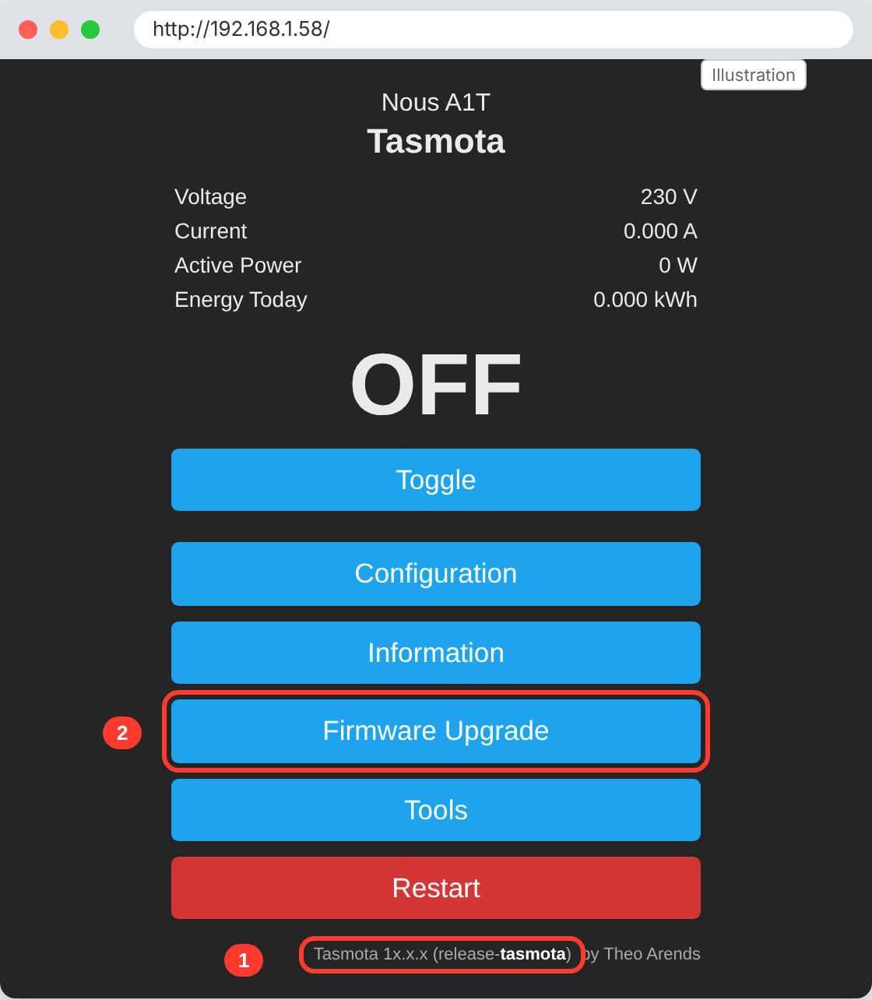
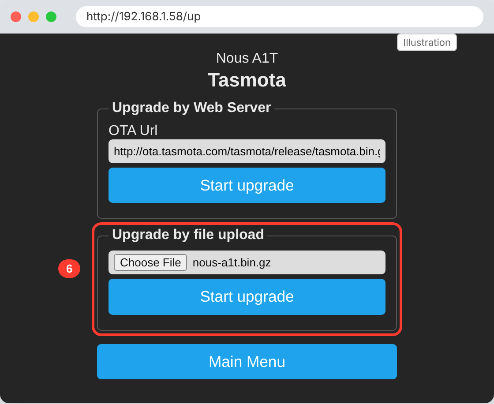
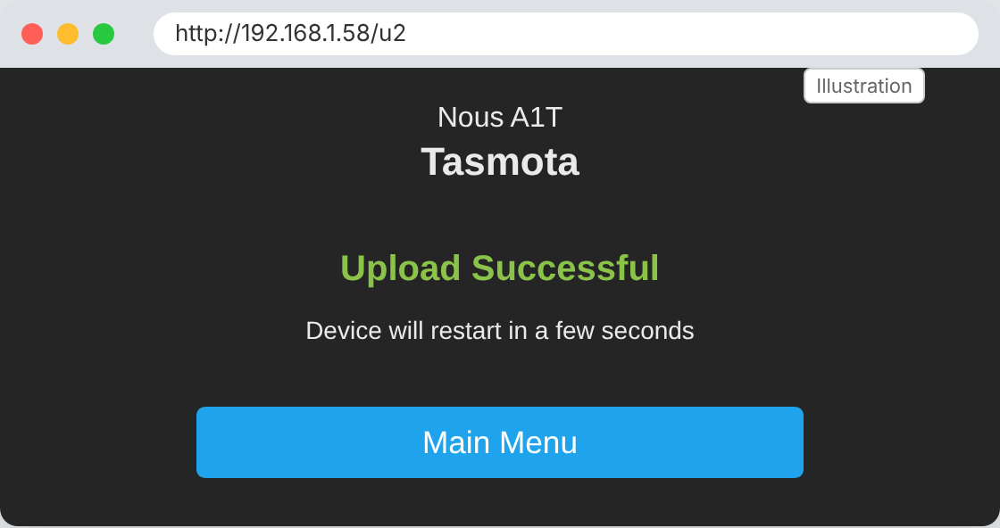
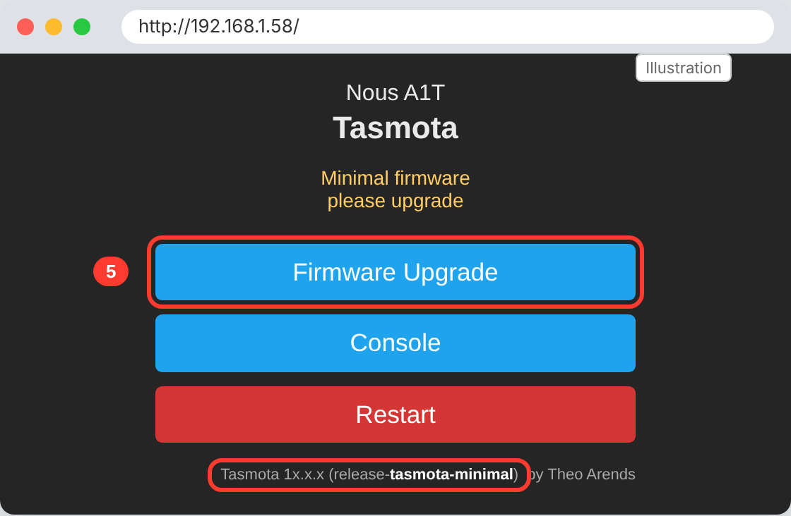

# ESPHome for the Nous A1T

🇬🇧 [English](#english) | 🇩🇪 [Deutsch](#deutsch)

---

<a id="english"></a>

## 🇬🇧 English

ESPHome firmware for the **Nous A1T** Wi-Fi smart plug (ESP8285, BL0937 power metering). The plug is converted **without opening it**: the ready-made firmware is simply uploaded through the web interface of the preinstalled Tasmota. No screwdriver, no USB-serial adapter, about 10 minutes.

### Files

| File | Content |
| --- | --- |
| `nous_a1t.bin.gz` | Precompiled, gzip-compressed firmware for direct upload via Tasmota |
| `nous_a1t_plug_V2.yaml` | ESPHome configuration the firmware is built from |

### Features

- Relay switchable from Home Assistant and via the button on the plug
- Measurement of voltage, current, power and daily energy (kWh), calibrated
- Overload shutdown above 2500 W with a notification in Home Assistant
- Relay state and energy counter survive a power failure
- Web interface at `http://<IP>/`
- Buttons for restart, safe mode and factory reset

**LED**

| LED | Meaning |
| --- | --- |
| blinks fast | no Wi-Fi (hotspot active) |
| slow "breathing" | connected, relay off |
| steady on | connected, relay on |

**Button**

| Action | Effect |
| --- | --- |
| short press | toggle relay |
| hold 10 s | LED blinks 5× fast, then factory reset |

### Hardware

| Function | GPIO |
| --- | --- |
| Relay | GPIO14 |
| Button | GPIO0 |
| LED (inverted, PWM) | GPIO13 |
| BL0937 SEL (inverted) | GPIO12 |
| BL0937 CF | GPIO4 |
| BL0937 CF1 | GPIO5 |

Chip: ESP8285 with 1 MB flash.

### Installation

#### What you need

- The Nous A1T with factory Tasmota, plugged into a socket, no load
- A browser on the same Wi-Fi network
- The file `nous_a1t.bin.gz` from this repository (click the file → **Download raw file**)

> **Note:** A power failure while writing can brick the plug; the only remedy then is opening it and flashing serially. The time window is short, but do not unplug the plug during the process.

#### 1. Open Tasmota

If the plug is new, it opens a hotspot `tasmota-xxxx`. Connect to it, open `192.168.4.1` and enter your Wi-Fi credentials. Then open the plug's IP address (shown in your router) in the browser.



The footer must read `tasmota` (not `tasmota32`). Then click **Firmware Upgrade**.

#### 2. Upload the firmware

Under **Upgrade by file upload**, select the file `nous_a1t.bin.gz` and click **Start upgrade**.



The file must keep the `.gz` extension: uncompressed, the firmware does not fit into the 1 MB flash next to the running Tasmota.



#### 3. Set up Wi-Fi

After the restart the LED blinks fast: ESPHome is running but does not know any Wi-Fi network yet.

1. Connect your phone or PC to the hotspot **`NOUS-Smart-Wifi-Socket`**.
2. The captive portal opens automatically; otherwise open `http://192.168.4.1`.
3. Select your Wi-Fi network, enter the password, save.

As soon as the plug is connected, the LED switches to breathing.

#### 4. Add to Home Assistant

Home Assistant discovers the plug automatically as a new ESPHome device (**Settings → Devices & services**). Click **Configure**, done. The name contains the last digits of the MAC address (`nous-a1t-xxxxxx`), so multiple plugs can be told apart.

### Building it yourself

If you want to change the configuration, e.g. hard-code Wi-Fi credentials or adjust `max_power`:

```bash
esphome compile nous_a1t_plug_V2.yaml
```

The firmware is then located at `.esphome/build/nous-a1t/.pioenvs/nous-a1t/firmware.bin`.

- **Plug already runs ESPHome:** simply update via OTA, without gzip:
  `esphome run nous_a1t_plug_V2.yaml --device <IP>`
- **First installation via Tasmota:** compress `firmware.bin` with gzip first.

  Linux/macOS:
  ```bash
  gzip -9 -k firmware.bin
  ```
  Windows with 7-Zip: right-click `firmware.bin` → **7-Zip** → **Add to archive…** → **Archive format: gzip** (the default is `7z`!) → **Compression level: Ultra**. Or on the command line:
  ```
  "C:\Program Files\7-Zip\7z.exe" a -tgzip -mx=9 firmware.bin.gz firmware.bin
  ```
  Only `.gz` works; Tasmota rejects `.zip`, `.7z` or `.tar.gz`.

### Calibration

The values in the YAML were determined on one unit using a Fluke 179 and a power meter (231 V mains voltage, 1792 W hair dryer):

```yaml
current_res: "0.000991"
voltage_div: "1551"
```

Other units may deviate by a few percent. To recalibrate, use a resistive load (hair dryer, fan heater, kettle) and a meter; correct the voltage first, then the power:

```
voltage_div_new = voltage_div × U_measured / U_displayed
current_res_new = current_res × P_displayed / P_measured × voltage_div_new / voltage_div
```

> **Caution:** The A1T template on devices.esphome.io (`775` / `0.00280`) works without `model:`, i.e. with the HLW8012 model. With `model: BL0937`, these values show only about half the voltage.

### Troubleshooting

| Symptom | Cause | Solution |
| --- | --- | --- |
| "Not enough space" or "Upload buffer miscompare" | File uncompressed, or not enough free flash | Check that it is the `.bin.gz`; otherwise take the detour via tasmota-minimal (see below) |
| Tasmota (old version) rejects the firmware | Image check in Tasmota 7.2+ | In the Tasmota console run `SetOption78 1`, restart, upload again |
| LED keeps blinking fast | No or wrong Wi-Fi | Connect to hotspot `NOUS-Smart-Wifi-Socket`, re-enter Wi-Fi |
| `nous-a1t.local` cannot be found | MAC suffix in the name or unreliable mDNS | Work with the IP (`--device <IP>`) |
| Voltage shows approx. 115 V | HLW8012 calibration values with `model: BL0937` | Use the values from this repository |
| Later OTA updates fail due to lack of space | Custom configuration too large for 1 MB | Remove `web_server` |

#### If there is not enough space

If Tasmota reports "Not enough space" despite the `.gz` file, nothing is broken; Tasmota keeps running. In that case first upload [`tasmota-minimal.bin.gz`](http://ota.tasmota.com/tasmota/release/tasmota-minimal.bin.gz) the same way. Tasmota then starts with a minimal interface; from there, upload `nous_a1t.bin.gz` via **Firmware Upgrade**.



Once ESPHome is running, never flash a tasmota-minimal image over it again; this can brick the plug.

#### Emergency: plug no longer boots

Then there is no way around opening it: flash serially via UART (TX, RX, GND, 3.3 V, GPIO0 pulled to GND at power-on) with `esptool`. **Never** connect the USB-serial adapter while the plug is connected to mains.

### Notes

- The screenshots are recreations of the Tasmota interface; version numbers differ.
- The configuration uses no API key and no OTA password, so the ready-made firmware fits every plug. If you want to secure it, add `api: encryption: key:` and `ota: password:` and build it yourself.
- Conversion at your own risk. Work on mains voltage only by qualified persons.

### Sources

- [Nous A1T – devices.esphome.io](https://devices.esphome.io/devices/nous-a1t/)
- [Migrating from Tasmota – ESPHome documentation](https://esphome.io/guides/migrate_sonoff_tasmota/)
- [Nous A1T Tasmota → ESPHome – Home Assistant Community](https://community.home-assistant.io/t/nous-a1t-tasmota-esphome/522530)

---

<a id="deutsch"></a>

## 🇩🇪 Deutsch

ESPHome-Firmware für die WLAN-Steckdose **Nous A1T** (ESP8285, BL0937-Leistungsmessung). Der Stecker wird **ohne Öffnen** umgestellt: Die fertige Firmware wird einfach über die Weboberfläche des vorinstallierten Tasmota hochgeladen. Kein Schraubendreher, kein USB-Seriell-Adapter, etwa 10 Minuten.

### Dateien

| Datei | Inhalt |
| --- | --- |
| `nous_a1t.bin.gz` | Fertig kompilierte, gzip-komprimierte Firmware zum direkten Hochladen über Tasmota |
| `nous_a1t_plug_V2.yaml` | ESPHome-Konfiguration, aus der die Firmware gebaut ist |

### Funktionen

- Relais schaltbar aus Home Assistant und über den Taster am Stecker
- Messung von Spannung, Strom, Leistung und Tagesenergie (kWh), kalibriert
- Überlastabschaltung ab 2500 W mit Benachrichtigung in Home Assistant
- Relaiszustand und Energiezähler überstehen einen Stromausfall
- Weboberfläche unter `http://<IP>/`
- Buttons für Neustart, Safe Mode und Werksreset

**LED**

| LED | Bedeutung |
| --- | --- |
| blinkt schnell | kein WLAN (Hotspot aktiv) |
| „atmet“ langsam | verbunden, Relais aus |
| dauerhaft an | verbunden, Relais an |

**Taster**

| Bedienung | Wirkung |
| --- | --- |
| kurz drücken | Relais umschalten |
| 10 s halten | LED blinkt 5× schnell, dann Werksreset |

### Hardware

| Funktion | GPIO |
| --- | --- |
| Relais | GPIO14 |
| Taster | GPIO0 |
| LED (invertiert, PWM) | GPIO13 |
| BL0937 SEL (invertiert) | GPIO12 |
| BL0937 CF | GPIO4 |
| BL0937 CF1 | GPIO5 |

Chip: ESP8285 mit 1 MB Flash.

### Installation

#### Was du brauchst

- Den Nous A1T mit werkseitigem Tasmota, in der Steckdose, ohne Last
- Einen Browser im selben WLAN
- Die Datei `nous_a1t.bin.gz` aus diesem Repository (Datei anklicken → **Download raw file**)

> **Hinweis:** Ein Stromausfall während des Schreibens kann den Stecker unbrauchbar machen; dann hilft nur noch Öffnen und seriell Flashen. Das Zeitfenster ist kurz, den Stecker währenddessen trotzdem nicht ausstecken.

#### 1. Tasmota aufrufen

Ist der Stecker neu, öffnet er einen Hotspot `tasmota-xxxx`. Damit verbinden, `192.168.4.1` aufrufen und dein WLAN eintragen. Danach die IP des Steckers (steht im Router) im Browser öffnen.


In der Fußzeile muss `tasmota` stehen (nicht `tasmota32`). Dann auf **Firmware Upgrade** klicken.

#### 2. Firmware hochladen

Unter **Upgrade by file upload** die Datei `nous_a1t.bin.gz` wählen und **Start upgrade** klicken.


Die Datei muss die Endung `.gz` behalten: Ungepackt passt die Firmware nicht neben das laufende Tasmota in den 1-MB-Flash.


#### 3. WLAN einrichten

Nach dem Neustart blinkt die LED schnell: ESPHome läuft, kennt aber noch kein WLAN.

1. Mit Handy oder PC den Hotspot **`NOUS-Smart-Wifi-Socket`** verbinden.
2. Das Captive Portal öffnet sich von selbst, sonst `http://192.168.4.1` aufrufen.
3. Dein WLAN wählen, Passwort eingeben, speichern.

Sobald der Stecker verbunden ist, wechselt die LED zum Atmen.

#### 4. In Home Assistant einbinden

Home Assistant findet den Stecker automatisch als neues ESPHome-Gerät (**Einstellungen → Geräte & Dienste**). Auf **Konfigurieren** klicken, fertig. Der Name enthält die letzten Stellen der MAC-Adresse (`nous-a1t-xxxxxx`), so lassen sich mehrere Stecker auseinanderhalten.

### Selbst bauen

Wer die Konfiguration ändern will, z. B. WLAN-Daten fest eintragen oder `max_power` anpassen:

```bash
esphome compile nous_a1t_plug_V2.yaml
```

Die Firmware liegt danach unter `.esphome/build/nous-a1t/.pioenvs/nous-a1t/firmware.bin`.

- **Stecker läuft schon mit ESPHome:** Einfach per OTA aktualisieren, ohne gzip:
  `esphome run nous_a1t_plug_V2.yaml --device <IP>`
- **Erstinstallation über Tasmota:** Die `firmware.bin` vorher mit gzip packen.

  Linux/macOS:
  ```bash
  gzip -9 -k firmware.bin
  ```
  Windows mit 7-Zip: Rechtsklick auf `firmware.bin` → **7-Zip** → **Zu einem Archiv hinzufügen…** → **Archivformat: gzip** (Voreinstellung ist `7z`!) → **Kompressionsstärke: Ultra**. Oder in der Kommandozeile:
  ```
  "C:\Program Files\7-Zip\7z.exe" a -tgzip -mx=9 firmware.bin.gz firmware.bin
  ```
  Nur `.gz` funktioniert; `.zip`, `.7z` oder `.tar.gz` lehnt Tasmota ab.

### Kalibrierung

Die Werte in der YAML wurden an einem Exemplar mit Fluke 179 und Leistungsmesser ermittelt (231 V Netzspannung, Fön 1792 W):

```yaml
current_res: "0.000991"
voltage_div: "1551"
```

Andere Exemplare können um einige Prozent abweichen. Zum Nachkalibrieren eine ohmsche Last (Fön, Heizlüfter, Wasserkocher) und ein Messgerät verwenden, erst die Spannung, dann die Leistung korrigieren:

```
voltage_div_neu = voltage_div × U_gemessen / U_angezeigt
current_res_neu = current_res × P_angezeigt / P_gemessen × voltage_div_neu / voltage_div
```

> **Achtung:** Die A1T-Vorlage auf devices.esphome.io (`775` / `0.00280`) rechnet ohne `model:`, also mit dem HLW8012-Modell. Mit `model: BL0937` zeigen diese Werte nur etwa die halbe Spannung an.

### Fehlersuche

| Symptom | Ursache | Lösung |
| --- | --- | --- |
| „Not enough space“ oder „Upload buffer miscompare“ | Datei ungepackt, oder zu wenig freier Flash | Prüfen, ob es die `.bin.gz` ist; sonst Umweg über tasmota-minimal (siehe unten) |
| Tasmota (alte Version) lehnt die Firmware ab | Image-Prüfung in Tasmota 7.2+ | In der Tasmota-Konsole `SetOption78 1`, Neustart, erneut hochladen |
| LED blinkt dauerhaft schnell | Kein oder falsches WLAN | Mit Hotspot `NOUS-Smart-Wifi-Socket` verbinden, WLAN neu eintragen |
| `nous-a1t.local` nicht auffindbar | MAC-Suffix im Namen oder mDNS unzuverlässig | Mit der IP arbeiten (`--device <IP>`) |
| Spannung zeigt ca. 115 V | HLW8012-Kalibrierwerte mit `model: BL0937` | Werte aus diesem Repository verwenden |
| Spätere OTA-Updates scheitern am Platz | Eigene Konfiguration zu groß für 1 MB | `web_server` entfernen |

#### Falls der Platz nicht reicht

Meldet Tasmota trotz `.gz`-Datei „Not enough space“, ist nichts kaputt, Tasmota läuft weiter. Dann zuerst [`tasmota-minimal.bin.gz`](http://ota.tasmota.com/tasmota/release/tasmota-minimal.bin.gz) auf demselben Weg hochladen. Tasmota startet danach mit einer Minimal-Oberfläche; dort über **Firmware Upgrade** die `nous_a1t.bin.gz` nachschieben.


Wenn ESPHome einmal läuft, nie wieder ein tasmota-minimal-Image darüberspielen; das kann den Stecker unbrauchbar machen.

#### Notfall: Stecker startet nicht mehr

Dann führt kein Weg am Öffnen vorbei: seriell über UART (TX, RX, GND, 3,3 V, GPIO0 beim Einschalten auf GND) und `esptool`. Den USB-Seriell-Adapter **niemals** anschließen, solange der Stecker am Netz hängt.

### Hinweise

- Die Screenshots sind Nachbildungen der Tasmota-Oberfläche; Versionsnummern weichen ab.
- Die Konfiguration nutzt keinen API-Schlüssel und kein OTA-Passwort, damit die fertige Firmware für jeden Stecker passt. Wer das absichern will, ergänzt `api: encryption: key:` und `ota: password:` und baut selbst.
- Umbau auf eigene Gefahr. Arbeiten an Netzspannung nur durch Fachkundige.

### Quellen

- [Nous A1T – devices.esphome.io](https://devices.esphome.io/devices/nous-a1t/)
- [Migrating from Tasmota – ESPHome-Dokumentation](https://esphome.io/guides/migrate_sonoff_tasmota/)
- [Nous A1T Tasmota → ESPHome – Home Assistant Community](https://community.home-assistant.io/t/nous-a1t-tasmota-esphome/522530)
